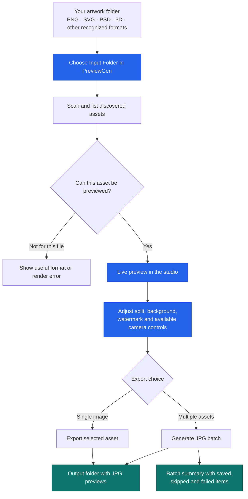
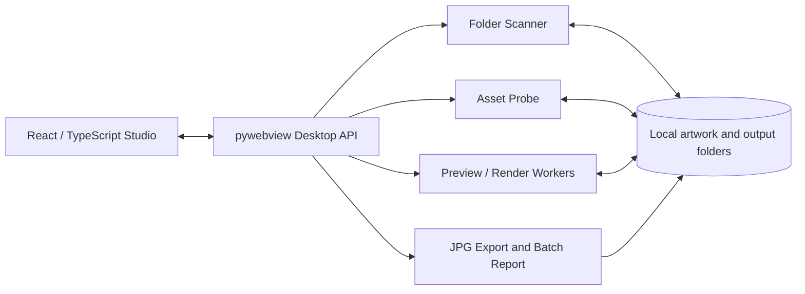

<div align="center">

<h1>PreviewGen Studio</h1>

<p><strong>Turn creative assets into presentation-ready JPG previews — right on your desktop.</strong></p>

<p>A free, open-source studio for digital artists, designers, marketplace contributors and 3D creators.<br>
Choose artwork, refine its presentation and generate consistent JPG previews in batches.</p>

<p>
  <a href="https://github.com/mustaqeem66/Freepik-Preview-Generator/releases/latest"><strong>Download PreviewGen</strong></a>
  &nbsp;·&nbsp;
  <a href="#getting-started">Get started</a>
  &nbsp;·&nbsp;
  <a href="#what-previewgen-can-do">Explore features</a>
  &nbsp;·&nbsp;
  <a href="https://github.com/mustaqeem66/Freepik-Preview-Generator/issues">Report an issue</a>
</p>

<p>
  
  
  
  
  
</p>

</div>

---

## 🚀 Install PreviewGen in one command

**✨ Recommended: use the terminal installer for the simplest guided setup.** It retrieves the latest *published* GitHub release, checks the download against its release SHA-256 manifest, and uses your operating system's installation path. No Python, Node.js or repository clone is required.

### 🪟 Windows — PowerShell

Open **PowerShell** and paste:

```powershell
irm https://raw.githubusercontent.com/mustaqeem66/Freepik-Preview-Generator/main/install.ps1 | iex
```

✅ Downloads and verifies `PreviewGen-Setup.exe`, then opens the regular Windows wizard. Choose the destination and optional desktop shortcut there.

### 🍎 macOS — Terminal

Open **Terminal** and paste:

```bash
curl -fsSL https://raw.githubusercontent.com/mustaqeem66/Freepik-Preview-Generator/main/install.sh -o install-previewgen.sh && bash install-previewgen.sh
```

✅ Downloads and verifies the DMG, then installs PreviewGen in **Applications**. macOS may still ask you to approve the first launch.

### 🐧 Linux — Terminal

Open **Terminal** and paste:

```bash
curl -fsSL https://raw.githubusercontent.com/mustaqeem66/Freepik-Preview-Generator/main/install.sh -o install-previewgen.sh && bash install-previewgen.sh
```

✅ Downloads and verifies the AppImage, installs it to `~/.local/bin/previewgen` and creates a desktop-menu entry.

> 🛡️ **Security note:** A terminal command is convenient, **not a way to bypass security warnings**. Windows SmartScreen and macOS Gatekeeper may still prompt, especially if a release lacks a trusted publisher signature or notarization. Verify the official download and do **not** disable Defender or Gatekeeper. Review the [Windows script](install.ps1) or [macOS/Linux script](install.sh) before executing them; direct PowerShell piping runs downloaded code immediately. See [Security and first-run warnings](#security-warnings).

Prefer clicking instead of using a command? See the [manual installer instructions](#manual-installation) for Windows, macOS and Linux.

---

## 🎨 Meet PreviewGen

Creating a professional preview for one transparent icon may be simple. Creating the *same consistent preview* for dozens or hundreds of cutouts, illustrations, models or design assets can take hours.

PreviewGen takes that repetitive work off your hands. Instead of opening every file in an editor, building a checkerboard, adding text, positioning the artwork and saving a JPEG, you set up your design once and let the app prepare the batch.

Its signature **diagonal-split composition** combines a solid-colored background with a printed checkerboard that *visually communicates* transparency. You can adjust colors, watermarks, output dimensions and supported 3D camera angles before exporting.

> **Important:** JPG files are opaque. PreviewGen's checkerboard is part of the rendered image; it is not an actual transparent JPG. PreviewGen helps present digital assets, but no marketplace's approval or compliance is guaranteed.

### 📸 PreviewGen in action

| Dark Studio | Light Studio |
| :---: | :---: |
|  |  |
| Comfortable for detail-focused creative work | A clean, bright workspace for everyday editing |

## 👩‍🎨 Who is PreviewGen for?

| You are a… | PreviewGen helps you… |
| --- | --- |
| 📸 **Stock marketplace contributor** | Prepare consistent JPG previews for assets you submit to sites such as Freepik, Adobe Stock or Shutterstock, subject to each marketplace's own rules |
| 🎨 **Icon or illustration designer** | Present transparent PNGs, SVGs and design packs with consistent colors and branding |
| 🧊 **3D artist or game-asset creator** | Preview supported meshes with camera/orbit controls and generate shareable JPG images |
| 🛍️ **Digital-product seller** | Create a cohesive set of presentation previews for listings or asset bundles on stores such as Etsy and Creative Market |
| 💼 **Freelancer or creative agency** | Save reusable presentation choices while preparing multiple client deliverables |
| 📐 **CAD or technical designer** | Inspect available rendered views or embedded previews where a format-specific renderer can read them |

The app is especially useful when you have **many different source files but want one recognizable visual style**.

<a id="what-previewgen-can-do"></a>
## ✨ What PreviewGen can do

### 👀 1. Preview your artwork before exporting

- Select a source folder and browse discovered supported assets in the library.
- View the generated preview in the central canvas.
- Navigate between items, adjust settings and export one preview or a batch.
- See meaningful errors when an individual source cannot be rendered.

### 🎨 2. Create a signature diagonal-split presentation

- Put a solid color on either side of the diagonal.
- Choose a preset or custom background color.
- Display a printed checkerboard on the opposite side to illustrate alpha/transparency.
- Preserve sensible proportions instead of stretching assets arbitrarily.

### ✍️ 3. Add your creative identity

- Add custom watermark text and adjust its color, scale, opacity and placement.
- Use outlines for legibility against the artwork.
- Choose a supported logo or font file where the renderer supports it.
- Apply a consistent presentation across a batch.

### 🧩 4. Work with 2D, vector, 3D and design files

PreviewGen recognizes raster images, layered/vector assets, 3D models, selected CAD/creator formats and ZIP archives. It uses format-specific rendering or embedded preview extraction as available.

**Discovery is not a universal file-conversion guarantee.** Some proprietary design projects do not contain usable thumbnails, and some models may be rejected for malformed data, missing features or resource limits. See [Supported formats & limitations](#supported-formats--limitations).

### 📦 5. Export many previews without babysitting each file

- Start batch generation with progress and cancellation controls.
- Choose an output folder and an existing-file handling policy.
- Review saved, failed or skipped files and export reports.
- Optionally enable system notifications when a batch finishes.

### 🔒 6. Keep your artwork local

PreviewGen is a **local-first desktop application**. Your artwork is processed on your computer, not uploaded to an online conversion website. Preview images use a temporary loopback-only local server. Installing or updating the app, of course, requires downloading packages from GitHub.

---

## 🔄 How it works

The flow below shows the user journey from a folder of creative assets to finished JPG previews.



**A typical example:** You have a folder of 40 transparent PNG icons. Choose it once, set a white-and-checkerboard split, enter your watermark, inspect a few samples, then export the whole folder to JPGs in one batch.

<a id="getting-started"></a>
## 🧭 Getting started

1. **Choose your artwork folder.** Use **Choose Input Folder** or paste a valid folder path.
2. **Wait for discovery.** PreviewGen lists recognized files; select one to see the live result.
3. **Adjust your design.** Set the split direction, background, watermark and any available 3D camera controls.
4. **Set a destination.** Choose **Same as input** or select an output folder.
5. **Export.** Generate the active preview or select **Generate Previews** for a batch.
6. **Review the output.** Open the output folder and check the JPGs and batch report.

> **Why does the folder dialog look empty?** It is a *folder picker*, so Windows/macOS may hide individual files. Select the **folder itself** using **Select Folder**. Its files appear in PreviewGen after scanning. A separate **Add Files** multi-select picker is a planned feature, not a current feature.

---

<a id="manual-installation"></a>
## 💾 Download and install manually

**💡 We recommend the one-command installation method above.** The options below are for people who prefer downloading files manually or choosing a portable build.

Use the official [**GitHub Releases page**](https://github.com/mustaqeem66/Freepik-Preview-Generator/releases/latest). The latest published release available when this guide was updated is **v2.1.2**.

| Operating system | Recommended release file | Installation experience |
| --- | --- | --- |
| **Windows 10/11** | `PreviewGen-Setup.exe` | Standard setup wizard with custom install folder and optional desktop shortcut |
| **Windows (portable)** | `PreviewGen-Windows.zip` | Unzip, then run `PreviewGen.exe`; no installation wizard |
| **macOS** | `PreviewGen-macOS.dmg` | Open the disk image, then copy PreviewGen to Applications |
| **Linux** | `PreviewGen-Linux.AppImage` | Mark executable, then run directly; optional desktop integration via installer script |

### 🪟 Windows — installer wizard

**🖱️ Manual installer — select a destination in the wizard**

1. Open [Latest Release](https://github.com/mustaqeem66/Freepik-Preview-Generator/releases/latest).
2. Download **`PreviewGen-Setup.exe`** (not the portable ZIP).
3. Run the setup wizard, choose your install directory, optionally select **Create a desktop icon**, and finish.
4. Launch PreviewGen from Start or its desktop shortcut.

The installer is configured for a **per-user installation**, with a default location under `%LOCALAPPDATA%\Programs\PreviewGen`. It provides a normal uninstaller through Windows Apps settings.

**⚡ Recommended PowerShell installer (same command shown at the top)**

Open **PowerShell** and run:

```powershell
irm https://raw.githubusercontent.com/mustaqeem66/Freepik-Preview-Generator/main/install.ps1 | iex
```

✅ This retrieves the **latest published release**, downloads `PreviewGen-Setup.exe`, verifies its SHA-256 against the release manifest, and opens the **same interactive wizard**. The script does **not** silently install a portable ZIP. The wizard and Windows security prompts, when applicable, still appear.

**🔍 Prefer reviewing downloaded scripts first?** Open [install.ps1](install.ps1) in GitHub and read it before running the command. A matching hash detects corruption or mismatch; it is not a substitute for confirming the publisher.

**Windows portable alternative:**

1. Download `PreviewGen-Windows.zip`.
2. Extract all its files to a normal folder.
3. Launch `PreviewGen.exe` inside the extracted folder.

The portable `PreviewGen.exe` starts immediately. It will not show a setup wizard or automatically create an installed-app entry.

### 🍎 macOS — disk image or Terminal

**🖱️ Manual installation from DMG**

1. Download `PreviewGen-macOS.dmg` from [GitHub Releases](https://github.com/mustaqeem66/Freepik-Preview-Generator/releases/latest).
2. Open the downloaded DMG.
3. Drag **PreviewGen.app** into **Applications**.
4. Open PreviewGen from Applications or Launchpad.

**⚡ Recommended Terminal installation — one line**

```bash
curl -fsSL https://raw.githubusercontent.com/mustaqeem66/Freepik-Preview-Generator/main/install.sh -o install-previewgen.sh && bash install-previewgen.sh
```

This downloads the latest released DMG, verifies its checksum, copies PreviewGen to `/Applications`, tries to create a Desktop shortcut, and launches the app. **Read `install-previewgen.sh` before running it.** If macOS refuses permission to modify Applications, use the manual DMG/Finder method or an administrator-approved installation path.

### 🐧 Linux — AppImage or Terminal

**🖱️ Manual portable AppImage**

Download `PreviewGen-Linux.AppImage` from the latest release, open a terminal in the download folder and run:

```bash
chmod +x PreviewGen-Linux.AppImage
./PreviewGen-Linux.AppImage
```

You can keep the AppImage anywhere you have access. Some Linux distributions need additional FUSE/AppImage compatibility packages or desktop permissions.

**⚡ Recommended Terminal installation with desktop integration — one line**

```bash
curl -fsSL https://raw.githubusercontent.com/mustaqeem66/Freepik-Preview-Generator/main/install.sh -o install-previewgen.sh && bash install-previewgen.sh
```

The installer downloads and checks the latest AppImage, places the executable at `~/.local/bin/previewgen`, creates a launcher in `~/.local/share/applications/` and attempts a Desktop shortcut when the Desktop directory exists.

After installation, you can start it from a terminal with:

```bash
~/.local/bin/previewgen
```

To remove a script-installed Linux copy:

```bash
~/.local/bin/previewgen-uninstall
```

**Install script note:** macOS/Linux checksum verification expects the exact published artifact names `PreviewGen-macOS.dmg` and `PreviewGen-Linux.AppImage`. Use a version of `install.sh` containing the corrected filename handling.

---

<a id="security-warnings"></a>
## 🛡️ Security and first-run warnings

**⚠️ Command-line installation cannot guarantee a warning-free launch.** Smaller open-source apps may display an operating-system warning, especially when a build has no recognized publisher signature or Apple notarization. **A warning is not automatically proof of malware; it is also not proof the app is safe.**

**Before opening any warning dialog**, download from this repository's official Releases page, check that the file has the expected name, review the release notes and verify the file against `SHA256SUMS.txt`. You can also check the OS signature details. A checksum from the *same compromised source* does not establish authenticity, so provenance matters too.

### 🪟 Windows: “Windows protected your PC” or “Unknown publisher”

If **Microsoft Defender SmartScreen** warns about an unrecognized app:

1. Confirm that you downloaded it from the repository's GitHub Releases page.
2. Confirm the downloaded file's hash and inspect **Properties → Digital Signatures**, if that tab exists.
3. If the warning is a *reputation* warning, you trust the release, and Windows offers it, choose **More info → Run anyway** to proceed.

**Do not turn off Windows Defender, disable real-time protection or create blanket antivirus exclusions.** If Defender reports a specific virus/trojan detection or quarantines the file, **stop** and report the detection and the release link to the maintainers rather than overriding protection.

Check a Windows download's hash in PowerShell:

```powershell
Get-FileHash .\PreviewGen-Setup.exe -Algorithm SHA256
Get-AuthenticodeSignature .\PreviewGen-Setup.exe | Format-List Status, SignerCertificate
```

Compare the SHA-256 value with the `PreviewGen-Setup.exe` entry in the same release's `SHA256SUMS.txt`. A missing publisher signature may explain a reputation warning, but a matching SHA-256 by itself does not prove a file is benign.

### 🍎 macOS: “Apple cannot verify this app” or “Unidentified developer”

When Gatekeeper blocks the first launch:

1. Confirm the download comes from the official release and its hash matches the release manifest.
2. Try opening **PreviewGen.app** once from **Applications**.
3. If macOS blocks it and you trust the download, open **System Settings → Privacy & Security** and look for **Open Anyway** associated with PreviewGen. Follow the system prompts if offered. On some macOS versions, Finder **Control-click → Open** is also available.
4. If macOS reports that an app is **damaged**, its signature is invalid, or it may harm your computer, stop and verify/report the release rather than bypassing those warnings.

**Do not disable Gatekeeper globally or strip quarantine attributes with a blanket Terminal command.** Some builds may be signed or notarized, and others may not be; verify the particular downloaded build rather than assuming either state.

Check the DMG checksum:

```bash
shasum -a 256 PreviewGen-macOS.dmg
```

### 🐧 Linux: permissions and trust

Linux may refuse to launch a downloaded AppImage until you mark it executable. Use `chmod +x` only for a verified download. Desktop launchers may also ask you to mark the file as trusted; this is desktop-environment specific. Do not run the application with `sudo` unless you have a specific documented reason.

**For maintainers:** The repository's release workflow contains signing/notarization requirements for tagged builds. Before describing any particular published binary as signed, verify its actual signature and release provenance. Users should not have to rely on a claim in the README alone.

---

## 🗂️ Supported formats & limitations

The following are the extensions recognized by PreviewGen's discovery configuration. Exact results depend on format, embedded preview availability, optional libraries, file health and resource limits.

| Asset group | Recognized extensions | What to expect |
| --- | --- | --- |
| Raster and layered artwork | `PNG`, `WebP`, `TIF`, `TIFF`, `PSD` | Image decoding and available composite/layered previews |
| Vector artwork | `SVG`, `SVGZ`, `AI`, `EPS` | Rasterized vectors or embedded previews when supported |
| 3D assets | `GLB`, `GLTF`, `OBJ`, `STL`, `PLY`, `3MF`, `DAE`, `BLEND` | Rendered geometry or available embedded preview; behavior varies by source |
| CAD and technical files | `DXF`, `DWG`, `MAX`, `F3D`, `MB`, `MA`, `STEP`, `STP`, `IGES`, `IGS` | Format-specific geometry render or thumbnail extraction; not a full replacement for authoring software |
| Creator and design files | `PROCREATE`, `BRUSH`, `BRUSHSET`, `CLIP`, `KRA`, `AFDESIGN`, `AFPHOTO`, `AFPUB`, `INDD`, `ABR` | Embedded preview or limited inspection where available |
| Font assets | `TTF`, `OTF`, `WOFF`, `WOFF2` | Source-dependent previews; fonts can also be used for watermark styling where supported |
| Archives | `ZIP` | Bounded scanning/extraction of recognized members, subject to safety limits |

**Resource safety:** The app enforces bounds on source file size, pixels, geometry, archive extraction and rendering time/memory. Files exceeding these limits can fail gracefully rather than rendering.

## ❓ Common questions

<details>
<summary><strong>Do I need Adobe Photoshop, AutoCAD or Blender installed?</strong></summary>

PreviewGen uses included renderers and available metadata/embedded thumbnails for many tasks, so you do not normally need to open each original authoring app just to make a preview. However, support for some proprietary native formats is limited and should not be interpreted as a guarantee of full project conversion.

</details>

<details>
<summary><strong>Why don't I see the files in the native folder selector?</strong></summary>

Because it is selecting a folder, not individual files. Select the folder itself; PreviewGen discovers supported files inside it afterward.

</details>

<details>
<summary><strong>Does PreviewGen upload my designs?</strong></summary>

Its normal preview and export workflow processes artwork locally. It does not need an online conversion service. Downloading releases and following repository links uses the internet.

</details>

<details>
<summary><strong>Will it guarantee acceptance on Freepik or Adobe Stock?</strong></summary>

No. Each marketplace has its own current submission rules. PreviewGen prepares consistent presentation images; always check the platform's actual requirements for your asset category.

</details>

<details>
<summary><strong>Why did Windows show “PreviewGen (Not Responding)”?</strong></summary>

That message means Windows detected an unresponsive window. It cannot identify a root cause by itself. Newer builds include local diagnostics to help distinguish a slow startup operation, blocked GUI message loop or renderer issue. Open **Diagnostics** in the toolbar when the app is responsive, or inspect the local logs; see [Windows Hang Investigation](docs/WINDOWS_HANG_INVESTIGATION.md). If the window is stuck, collect the error and steps carefully rather than repeatedly force-launching copies.

</details>

<details>
<summary><strong>Does the installation script automatically keep PreviewGen updated?</strong></summary>

No. The scripts fetch the latest *published release when executed*. They do not install unreleased changes from `main` or provide an ongoing background updater.

</details>

---

## 🛠️ For developers

PreviewGen combines a React/TypeScript frontend with a Python desktop backend. Work such as file scanning, asset probing and rendering is delegated to coordinated or isolated workers to keep UI operations responsive where possible.



### 💻 Run locally

CI uses **Python 3.12.8** and **Node.js 24.15.0**.

```bash
git clone https://github.com/mustaqeem66/Freepik-Preview-Generator.git
cd Freepik-Preview-Generator

python -m venv .venv
# Windows PowerShell: .venv\Scripts\Activate.ps1
# macOS / Linux: source .venv/bin/activate

python -m pip install --require-hashes -r requirements-dev-lock.txt

cd frontend
npm ci
npm run build
cd ..

python app.py
```

Run the regression checks:

```bash
python -m ruff check .
python -m pytest tests/ -q

cd frontend
npm run typecheck
npm test
npm run build
```

Renderer/environment checks may require additional system support:

```bash
python scripts/verify_environment.py
python app.py --render-test-all --fixtures tests/fixtures
```

The repository includes further technical documentation in [`docs/`](docs/), an [issue tracker](https://github.com/mustaqeem66/Freepik-Preview-Generator/issues) and a [security reporting policy](SECURITY.md). Windows/macOS native dialogs, code signing and frozen release behavior should be checked on their actual operating systems; unit tests are not proof of full compatibility.

## 🤝 License, privacy and contributions

PreviewGen is licensed under the **[MIT License](LICENSE)**. You may use it for personal or commercial work under the license terms.

Your source artwork and export settings remain on your computer in normal use. PreviewGen writes settings, caches, reports and local diagnostic logs. If you report a bug, please **remove sensitive file paths and artwork from any shared logs or screenshots**. Report security issues privately via [SECURITY.md](SECURITY.md).

Contributions, reproducible bug reports, renderer fixtures and UI suggestions are welcome through [GitHub Issues](https://github.com/mustaqeem66/Freepik-Preview-Generator/issues) and pull requests.

---

<div align="center">
<h3>Make every asset presentation-ready.</h3>
<p><strong>Created and maintained by <a href="https://github.com/mustaqeem66">Mustaqeem66</a> (ZenArtisan).</strong></p>
<p>
  <a href="https://github.com/mustaqeem66/Freepik-Preview-Generator/releases/latest">Download the latest release</a>
  &nbsp;·&nbsp;
  <a href="https://github.com/mustaqeem66/Freepik-Preview-Generator">View source</a>
  &nbsp;·&nbsp;
  <a href="https://github.com/mustaqeem66/Freepik-Preview-Generator/issues">Report an issue</a>
</p>
<p>If PreviewGen helps with your creative workflow, consider starring the repository.</p>
</div>
