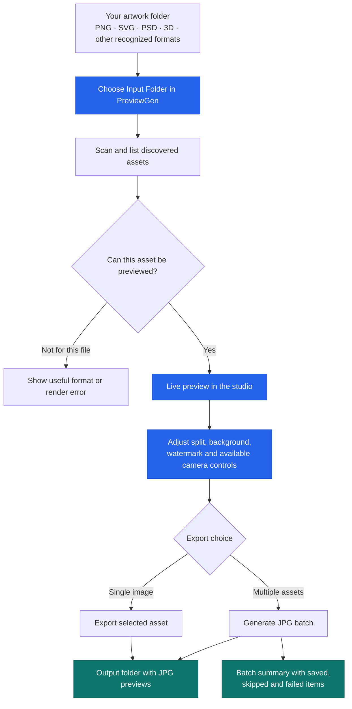
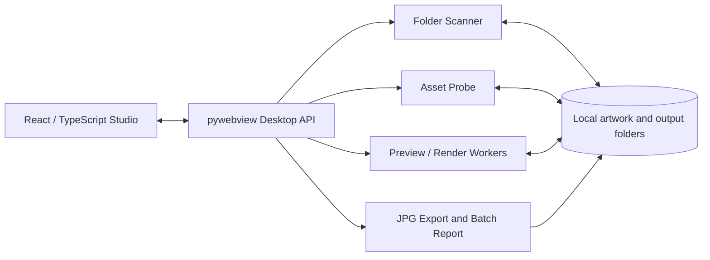

<div align="center">

<h1>PreviewGen Studio</h1>

<p><strong>Turn creative assets into presentation-ready JPG previews — right on your desktop.</strong></p>

<p>A free, open-source studio for digital artists, designers, marketplace contributors and 3D creators.<br>
Choose artwork, refine its presentation and generate consistent JPG previews in batches.</p>

<p>
  <a href="https://github.com/mustaqeem66/Freepik-Preview-Generator/releases/latest"><strong>Download PreviewGen</strong></a>
  &nbsp;·&nbsp;
  <a href="#getting-started">Get started</a>
  &nbsp;·&nbsp;
  <a href="#what-previewgen-can-do">Explore features</a>
  &nbsp;·&nbsp;
  <a href="https://github.com/mustaqeem66/Freepik-Preview-Generator/issues">Report an issue</a>
</p>

<p>
  
  
  
  
  
</p>

</div>

---

## 🚀 Install PreviewGen from your terminal

**⚡ Recommended:** use the official installer script for a quick, guided setup. No Python, Node.js or repository clone is needed.

### 🪟 Windows — PowerShell

```powershell
irm https://raw.githubusercontent.com/mustaqeem66/Freepik-Preview-Generator/main/install.ps1 | iex
```

Opens the normal Windows installation wizard after downloading and checking the published installer.

### 🍎 macOS & 🐧 Linux — Terminal

```bash
curl -fsSL https://raw.githubusercontent.com/mustaqeem66/Freepik-Preview-Generator/main/install.sh -o install-previewgen.sh && bash install-previewgen.sh
```

- **🍎 macOS:** installs the verified DMG application into **Applications**.
- **🐧 Linux:** installs the verified AppImage and creates a desktop-menu entry.

Both scripts fetch the **latest published release when you run them**; they do not install ongoing automatic updates. **Review the [Windows script](install.ps1) or [macOS/Linux script](install.sh) before executing downloaded code.**

Prefer downloading packages yourself? See [manual installation](#manual-installation). For first-launch publisher or OS security prompts, see [Security and first-run warnings](#security-warnings).

---

## 🎨 Meet PreviewGen

Creating a professional preview for one transparent icon may be simple. Creating the *same consistent preview* for dozens or hundreds of cutouts, illustrations, models or design assets can take hours.

PreviewGen takes that repetitive work off your hands. Instead of opening every file in an editor, building a checkerboard, adding text, positioning the artwork and saving a JPEG, you set up your design once and let the app prepare the batch.

The signature **diagonal-split preview** lets a collection of unrelated files share a recognizable visual style, while the studio gives you control before you export.

PreviewGen prepares presentation images; each marketplace still determines its own submission and acceptance requirements.

### 📸 PreviewGen in action

| Dark Studio | Light Studio |
| :---: | :---: |
|  |  |
| Comfortable for detail-focused creative work | A clean, bright workspace for everyday editing |

## 👩‍🎨 Who is PreviewGen for?

| You are a… | PreviewGen helps you… |
| --- | --- |
| 📸 **Stock marketplace contributor** | Prepare consistent JPG previews for assets you submit to sites such as Freepik, Adobe Stock or Shutterstock, subject to each marketplace's own rules |
| 🎨 **Icon or illustration designer** | Present transparent PNGs, SVGs and design packs with consistent colors and branding |
| 🧊 **3D artist or game-asset creator** | Preview supported meshes with camera/orbit controls and generate shareable JPG images |
| 🛍️ **Digital-product seller** | Create a cohesive set of presentation previews for listings or asset bundles on stores such as Etsy and Creative Market |
| 💼 **Freelancer or creative agency** | Save reusable presentation choices while preparing multiple client deliverables |
| 📐 **CAD or technical designer** | Inspect available rendered views or embedded previews where a format-specific renderer can read them |

The app is especially useful when you have **many different source files but want one recognizable visual style**.

<a id="what-previewgen-can-do"></a>
## ✨ What PreviewGen can do

### 👀 1. Preview your artwork before exporting

- Select a source folder and browse discovered supported assets in the library.
- View the generated preview in the central canvas.
- Navigate between items, adjust settings and export one preview or a batch.
- See meaningful errors when an individual source cannot be rendered.

### 🎨 2. Create a signature diagonal-split presentation

- Put a solid color on either side of the diagonal.
- Choose a preset or custom background color.
- Display a printed checkerboard on the opposite side to illustrate alpha/transparency.
- Preserve sensible proportions instead of stretching assets arbitrarily.

### ✍️ 3. Add your creative identity

- Add custom watermark text and adjust its color, scale, opacity and placement.
- Use outlines for legibility against the artwork.
- Choose a supported logo or font file where the renderer supports it.
- Apply a consistent presentation across a batch.

### 🧩 4. Work with 2D, vector, 3D and design files

PreviewGen recognizes raster images, layered/vector assets, 3D models, selected CAD/creator formats and ZIP archives. It uses format-specific rendering or embedded preview extraction as available.

**Discovery is not a universal file-conversion guarantee.** Some proprietary design projects do not contain usable thumbnails, and some models may be rejected for malformed data, missing features or resource limits. See [Supported formats & limitations](#supported-formats--limitations).

### 📦 5. Export many previews without babysitting each file

- Start batch generation with progress and cancellation controls.
- Choose an output folder and an existing-file handling policy.
- Review saved, failed or skipped files and export reports.
- Optionally enable system notifications when a batch finishes.

### 🔒 6. Keep your artwork local

PreviewGen processes artwork on your computer using a loopback-only preview server rather than an online conversion service. App downloads are provided through GitHub.

---

## 🔄 How it works

The flow below shows the user journey from a folder of creative assets to finished JPG previews.



<a id="getting-started"></a>
<a id="getting-started"></a>
## 🧭 Your first launch

The native **Choose Input Folder** dialog selects directories, so it may not display individual artwork files. Select the *containing folder* and confirm with **Select Folder**; PreviewGen lists supported assets after scanning. Direct individual-file selection is not yet available.

**Tip:** JPG files do not support transparency. The checkerboard is deliberately printed in the presentation preview; your original transparent artwork remains separate.

---

<a id="manual-installation"></a>
## 💾 Download and install manually

Prefer a graphical installer or a portable package? All files are available on the [official GitHub Releases page](https://github.com/mustaqeem66/Freepik-Preview-Generator/releases/latest).

### 🪟 Windows

**Normal installation — `PreviewGen-Setup.exe`:** Download and launch the installer, choose an installation directory and optionally create a Desktop icon. It also registers an uninstaller under Windows Apps settings. The default per-user location is `%LOCALAPPDATA%\Programs\PreviewGen`.

**Portable — `PreviewGen-Windows.zip`:** Extract the ZIP and run `PreviewGen.exe` from the extracted folder. Portable mode has no installer wizard or automatic installed-app entry.

### 🍎 macOS

Download `PreviewGen-macOS.dmg`, open it, then drag **PreviewGen.app** into **Applications**. Launch the app from Applications or Launchpad.

### 🐧 Linux

Download `PreviewGen-Linux.AppImage`. In a terminal opened in its folder:

```bash
chmod +x PreviewGen-Linux.AppImage
./PreviewGen-Linux.AppImage
```

The AppImage can run without being installed system-wide. Depending on your distro, FUSE compatibility may be required.

For a Linux installation made through the terminal script above, you can later uninstall it with:

```bash
~/.local/bin/previewgen-uninstall
```

---

<a id="security-warnings"></a>
## 🛡️ Security and first-run warnings

**⚠️ A terminal installer does not bypass SmartScreen, Defender or Gatekeeper.** Some releases may be unsigned or unnotarized. A reputation warning alone does not prove malware, but a matching checksum alone cannot prove software is safe.

**Before proceeding:** use [official Releases](https://github.com/mustaqeem66/Freepik-Preview-Generator/releases/latest), review the release notes and compare the downloaded file's SHA-256 against that release's `SHA256SUMS.txt`. A checksum from the same source provides integrity checking, not independent publisher authentication.

### 🪟 Windows — SmartScreen or “Unknown publisher”

Check the downloaded installer in PowerShell:

```powershell
Get-FileHash .\PreviewGen-Setup.exe -Algorithm SHA256
Get-AuthenticodeSignature .\PreviewGen-Setup.exe | Format-List Status, SignerCertificate
```

If it is **only a SmartScreen reputation warning**, and you have verified and trust the release, Windows may offer **More info → Run anyway**. If Defender detects or quarantines a specific threat, **stop and report it** rather than creating an exception or disabling antivirus.

### 🍎 macOS — Gatekeeper or “Unidentified developer”

Check the downloaded DMG:

```bash
shasum -a 256 PreviewGen-macOS.dmg
```

If Gatekeeper blocks the first launch and you trust the verified download, check **System Settings → Privacy & Security → Open Anyway**. Some macOS versions also allow **Control-click → Open** in Finder. If macOS warns the app is damaged or harmful, stop and report it instead of bypassing protection.

### 🐧 Linux — AppImage permissions

The manual AppImage executable-permission step is in [manual installation](#manual-installation). Some desktop environments additionally ask you to trust launchers. Do not run the app with `sudo` merely to bypass a permission warning.

**Never disable Windows Defender or Gatekeeper globally for PreviewGen.** Signing and notarization must be verified for the *specific released binary*; repository build configuration alone is not proof of signing.

---

<a id="supported-formats--limitations"></a>
## 🗂️ Supported formats & limitations

The following are the extensions recognized by PreviewGen's discovery configuration. Exact results depend on format, embedded preview availability, optional libraries, file health and resource limits.

| Asset group | Recognized extensions | What to expect |
| --- | --- | --- |
| Raster and layered artwork | `PNG`, `WebP`, `TIF`, `TIFF`, `PSD` | Image decoding and available composite/layered previews |
| Vector artwork | `SVG`, `SVGZ`, `AI`, `EPS` | Rasterized vectors or embedded previews when supported |
| 3D assets | `GLB`, `GLTF`, `OBJ`, `STL`, `PLY`, `3MF`, `DAE`, `BLEND` | Rendered geometry or available embedded preview; behavior varies by source |
| CAD and technical files | `DXF`, `DWG`, `MAX`, `F3D`, `MB`, `MA`, `STEP`, `STP`, `IGES`, `IGS` | Format-specific geometry render or thumbnail extraction; not a full replacement for authoring software |
| Creator and design files | `PROCREATE`, `BRUSH`, `BRUSHSET`, `CLIP`, `KRA`, `AFDESIGN`, `AFPHOTO`, `AFPUB`, `INDD`, `ABR` | Embedded preview or limited inspection where available |
| Font assets | `TTF`, `OTF`, `WOFF`, `WOFF2` | Source-dependent previews; fonts can also be used for watermark styling where supported |
| Archives | `ZIP` | Bounded scanning/extraction of recognized members, subject to safety limits |

**Resource safety:** The app enforces bounds on source file size, pixels, geometry, archive extraction and rendering time/memory. Files exceeding these limits can fail gracefully rather than rendering.

## ❓ Common questions

<details>
<summary><strong>Do I need Photoshop, AutoCAD or Blender installed?</strong></summary>

PreviewGen can render or read embedded previews for many formats without opening their authoring applications. Full project conversion is not guaranteed, especially for proprietary native files.

</details>

<details>
<summary><strong>What should I do if Windows reports “PreviewGen (Not Responding)”?</strong></summary>

An unresponsive window does not reveal the underlying cause. When the interface responds, open **Diagnostics** in the toolbar; otherwise see [Windows Hang Investigation](docs/WINDOWS_HANG_INVESTIGATION.md) for safe log collection and reproduction steps. Share only redacted diagnostics.

</details>

---

## 🛠️ For developers

PreviewGen combines a React/TypeScript frontend with a Python desktop backend. Work such as file scanning, asset probing and rendering is delegated to coordinated or isolated workers to keep UI operations responsive where possible.



### 💻 Run locally

CI uses **Python 3.12.8** and **Node.js 24.15.0**.

```bash
git clone https://github.com/mustaqeem66/Freepik-Preview-Generator.git
cd Freepik-Preview-Generator

python -m venv .venv
# Windows PowerShell: .venv\Scripts\Activate.ps1
# macOS / Linux: source .venv/bin/activate

python -m pip install --require-hashes -r requirements-dev-lock.txt

cd frontend
npm ci
npm run build
cd ..

python app.py
```

Run the regression checks:

```bash
python -m ruff check .
python -m pytest tests/ -q

cd frontend
npm run typecheck
npm test
npm run build
```

Renderer/environment checks may require additional system support:

```bash
python scripts/verify_environment.py
python app.py --render-test-all --fixtures tests/fixtures
```

The repository includes further technical documentation in [`docs/`](docs/), an [issue tracker](https://github.com/mustaqeem66/Freepik-Preview-Generator/issues) and a [security reporting policy](SECURITY.md). Windows/macOS native dialogs, code signing and frozen release behavior should be checked on their actual operating systems; unit tests are not proof of full compatibility.

## 🤝 License, privacy and contributions

PreviewGen is licensed under the **[MIT License](LICENSE)**. You may use it for personal or commercial work under the license terms.

Settings, caches, reports and diagnostic logs are stored locally. When sharing a bug report, **redact personal file paths and artwork**; report security issues privately through [SECURITY.md](SECURITY.md).

Contributions, reproducible bug reports, renderer fixtures and UI suggestions are welcome through [GitHub Issues](https://github.com/mustaqeem66/Freepik-Preview-Generator/issues) and pull requests.

---

<div align="center">

**Made for creative workflows.** · Maintained by [Mustaqeem66](https://github.com/mustaqeem66).

⭐ If PreviewGen helps you, consider starring the repository.

</div>
